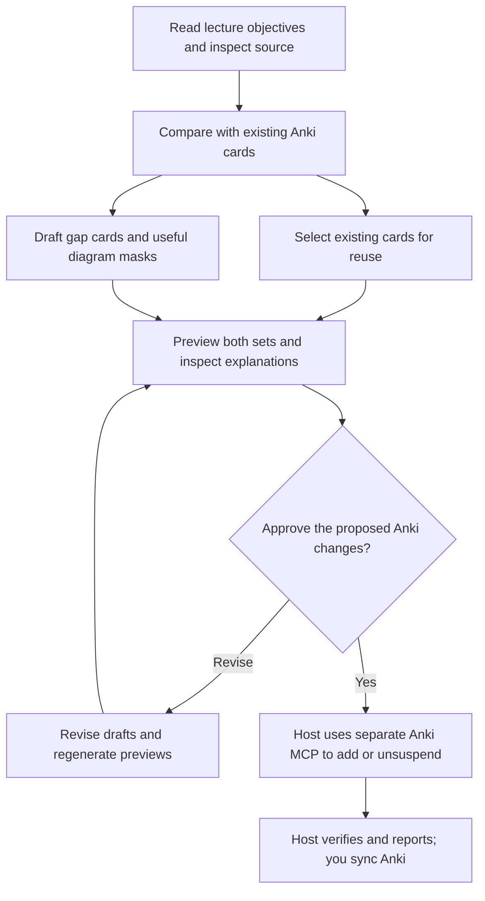

# AnkiPlus MCP

**Turn lecture material into flashcards you can inspect, improve and send to Anki—with help from your AI assistant.**

AnkiPlus gives an AI assistant tools to read lecture PDFs, find diagrams, recognise
image labels, build image occlusions, check card formatting and show previews.
You describe the study task in ordinary language; your assistant chooses which
tools to use and drafts the questions. You can also work on existing cards or
pasted notes without starting from a PDF.

MCP (Model Context Protocol) is how an AI app connects to tools. AnkiPlus is an
MCP server running locally on your computer. It has no chat interface of its own.
Use it through a compatible host such as Claude Code, Claude Desktop or Codex.

[Install](#install) · [First run](#first-run) · [How a lecture goes](#how-a-lecture-goes) · [Troubleshooting](#troubleshooting) · [Student setup](docs/student-setup.md) · [Worked lecture workflow](docs/study-workflow.md) · [All 42 tools](docs/tools.md) · [Matching existing decks](docs/matching.md) · [Setup guide](docs/setup.md) · [Developer guide](docs/developer-guide.md)

## What can it help you do?

| Your study task | What AnkiPlus provides |
| --- | --- |
| Make cards from a lecture | Extracted text, slide references, figures and learning objectives for your assistant to draft from. |
| Reuse cards you already own | A local index of your Anki collection. Each lecture line is matched without AI, and you get an unsuspend list for Claude to judge and you to approve, plus a drafting prompt with only the gaps. Unsuspension itself runs through the Anki MCP. |
| Learn a labelled diagram | OCR label regions and image-occlusion masks that hide labels for recall practice. |
| Check how cards will look | Front/back images and contact sheets: several card previews on one image. |
| Improve an existing deck | Local snapshots, formatting checks, optional review proposals and a preview of suggested field changes. |
| Keep track of coverage | Optional checks against extracted slides/objectives, with recorded reasons for deliberate omissions. |
| Get cards into Anki | Validated create/update payloads, media references and text import files. Your assistant handles the Anki connection separately. |

A **cloze** card hides part of a sentence, such as “The {{c1::mitochondrion}}
produces ATP.” An **image occlusion** hides a region of a diagram. A **workspace**
is a local folder holding one task's source snapshot, cards, previews and results,
so your assistant can return to it later.

## How it fits together

| Part | Responsibility |
| --- | --- |
| **You** | Choose the learning goal and inspect the cards before studying. |
| **Your AI assistant** | Understand the material, draft questions, choose tools and evaluate proposed changes. |
| **AnkiPlus MCP** | Do mechanical work: extraction, OCR, masks, validation, previews and payload preparation. |
| **A separate Anki MCP** | Read your Anki collection and execute additions, updates, media storage or suspension requested through your host. |

AnkiPlus never changes your Anki collection: it only reads a private copy to build its index. Configure the companion
Anki MCP separately if you want collection access. Source extraction, local card
checks and payload preparation can run without an Anki connection. You can also
use the generated text import files through Anki's import interface.

There is no compulsory pipeline or reviewer panel. Ask for one diagram, a few
slides, a preview of existing cards, or a full lecture task. AI drafting and
reviews can contain mistakes; formatting and coverage checks do not establish
that a fact is correct.

## Install

Pick one. All three end in the same place: AnkiPlus registered in your AI app, reading your
Anki collection directly. Card writes go through the **AnkiMCP add-on** inside Anki, so install
that add-on in Anki too.

### A. Desktop app (easiest, no Terminal)

Download the newest build from the [releases page](https://github.com/adeelahmad/ankiplusMCP/releases).
These test builds are **not signed**, so macOS and Windows each ask once.

| System | File | First open |
| --- | --- | --- |
| Mac (Apple Silicon, macOS 13.4+) | `AnkiPlus_*_aarch64.pkg` | Open it → macOS says it "cannot verify" → **Done** → **System Settings → Privacy & Security** → **Open Anyway** → password. The installer clears the security flag, so later opens are a normal double-click. |
| Mac, disk image | `AnkiPlus_*.dmg` | Drag **AnkiPlus** to **Applications**, then right-click it → **Open** → **Open** (once). |
| Windows 10/11 | `AnkiPlus_*-setup.exe` | "Windows protected your PC" → **More info** → **Run anyway**. |

No prompts at all on a Mac: paste this into **Terminal** (it downloads the newest build,
installs it, clears the flag and opens it):

```sh
curl -fsSL https://raw.githubusercontent.com/adeelahmad/ankiplusMCP/main/scripts/install-desktop.sh | sh
```

Intel Macs are not supported yet (ONNX Runtime ships no x86_64 macOS binaries). Full steps:
[installing the desktop app](rust/docs/install-unsigned.md).

### B. One command, no app (Mac, Linux, Windows)

```sh
curl -LsSf https://raw.githubusercontent.com/adeelahmad/ankiplusMCP/main/scripts/install.sh | sh
```

```powershell
irm https://raw.githubusercontent.com/adeelahmad/ankiplusMCP/main/scripts/install.ps1 | iex
```

It installs what is missing (uv, Node.js, Tesseract), registers AnkiPlus in Claude Desktop,
creates `Documents/Lectures`, downloads the matching model once and runs `doctor`. Running it
again is safe, and it replaces an older AnkiPlus entry (for example Hamza-Xoho's) with a
backup. See [student setup](docs/student-setup.md).

### C. Manual, pinned to a release

Releases are published as `release-v<version>` branches. The current one is **`release-v0.5.4`**.

```sh
npx -y github:adeelahmad/ankiplusMCP#release-v0.5.4 init --host claude-code --source-root /absolute/lectures
npx -y github:adeelahmad/ankiplusMCP#release-v0.5.4 doctor
npx -y github:adeelahmad/ankiplusMCP#release-v0.5.4 setup
```

`--host` can be `claude-desktop`, `claude-code`, `codex`, `opencode` or `hermes`; `init --print`
prints a snippet for any other host. You need Node.js 18+ and
[uv](https://docs.astral.sh/uv/getting-started/installation/); the server runs on Python 3.13.
See [host setup and options](docs/setup.md#install-and-register).

## First run

1. **Pick your Anki profile and deck.** The desktop app's first screen finds your profile and
   lists your decks (for example AnKing). Without the app, ask: "List my Anki profiles."
2. **Index the deck.** AnkiPlus reads a private copy of `collection.anki2`, so Anki can stay
   open and nothing needs exporting. The first run downloads the search model (Nomic,
   about 0.5 GB with the desktop app) and embeds every note: a few minutes in the app, up to
   about an hour for all of AnKing on a laptop. Ask: "Index my AnKing deck."
3. **Connect your AI app.** The desktop app's third step adds AnkiPlus to Claude Desktop and
   backs up the old settings file. Then **quit Claude Desktop completely** and reopen it.
4. **Re-sync is automatic.** Before each lecture match, an index built from an Anki profile
   re-reads the collection and re-embeds only new or changed notes (by note id and a hash of
   the text), so AnkiHub updates are picked up. Cards you write are added straight away.

## How a lecture goes

> Make cards from Lectures/L025.pdf. Skip what my deck already has.

1. **Matching, no AI.** `match_source` splits the lecture into lines (each bullet keeps its
   heading) and searches the indexed deck with BM25 plus local embeddings. Each line is
   `covered`, `related`, `gap` or `conflict` (the deck states a different number). Search
   costs **0 model tokens**. Details: [matching existing decks](docs/matching.md).
2. **Unsuspend review.** For covered lines, AnkiPlus proposes only the cloze siblings whose
   hidden answer the lecture says. Lines just below "covered" add up to 3 candidates each,
   again only cards whose hidden answer the line names. Claude reads each card's question and
   answer, drops topic-only matches (`exclude_note_ids`) and adds the candidates that do test
   the line (`include_note_ids`) with `prepare_unsuspend`. You see the list; nothing changes in
   Anki until you approve. Cards already unsuspended are never offered again.
3. **Custom cards for the gaps.** The drafting prompt lists only gaps, partial matches and
   conflicts. A coverage pass asks for a definition card for every term the lecture defines
   and, for anatomy, each structure's nerve, blood and lymph supply. `check_source_support`
   checks each card against the lecture text and flags list clozes and cut sentences.
4. **Image occlusion.** `list_figures`, `ocr_image` and `build_occlusion` turn labelled
   diagrams into Image Occlusion notes. OCR combines several Tesseract modes, so more labels
   are found. Claude fixes label spelling while viewing the figure; automatic spelling
   correction is off on purpose (it turned Foliate into Folate).
5. **Write and sync.** Approved cards go to Anki through the AnkiMCP add-on. Sync Anki
   afterwards.

**Highlights.** For a textbook or long PDF, highlight what matters in any viewer (Preview,
Acrobat, Skim), save, and ask "Match only my highlights in Lectures/chapter5.pdf".
`read_highlights` also picks up boxes drawn over figures.

**Compared with the legacy workflow** on the same lectures, AnkiPlus made 22 image-occlusion
notes where the legacy run made none, and its cost per lecture stays flat as the deck grows.
The legacy run's strengths, judging each card by its question and answer and wider definition
coverage, are now built in. See [the comparison](docs/legacy-comparison.md).

## Troubleshooting

| Symptom | Fix |
| --- | --- |
| Mac: "AnkiPlus is damaged" or "cannot be opened" | Paste `xattr -dr com.apple.quarantine /Applications/AnkiPlus.app` into Terminal, or use **Open Anyway** in Privacy & Security. Or install with the one-line `install-desktop.sh` above, which never triggers this. |
| Mac: no Open Anyway button | Open the app once first (it gets blocked), then look again in **System Settings → Privacy & Security**, near the bottom. |
| AnkiPlus tools don't show in Claude | Quit Claude Desktop completely (Claude menu → Quit) and reopen it. Then run `doctor`. |
| Server won't start: onnxruntime has no wheel | Use `release-v0.5.3` or newer. Those pin Python 3.13, because Python 3.15 has no onnxruntime wheels. |
| Index falls back to the file store | Normal on CPUs without AVX-512: the bundled pgvector needs it. Matching results are the same. |
| A lecture PDF won't open from Google Drive | Make the file available offline in Drive, then try again. |
| Anything else | `npx -y github:adeelahmad/ankiplusMCP#release-v0.5.4 doctor` prints each missing item and its fix. See [setup troubleshooting](docs/setup.md#troubleshooting). |

## Study with it

### Reuse existing cards and fill the gaps

> Read the learning objectives in this lecture. Match it against my indexed deck
> and suggest cards that already cover them. Draft new cards only for
> the gaps. Give new cards useful explanations and relevant lecture images on
> their backs. Use image occlusion where identifying labels is a learning goal.
> Show every proposed existing and new card, including both sides, and wait for
> my approval before changing Anki.

AnkiPlus finds the candidates without AI; whether a card really tests the line is
your assistant's judgement, from each card's question and answer. Ask it to show which objective each proposed card covers,
identify conflicts with your lecture, and explain any omissions.

A typical task looks like this; it is an example, not a required pipeline:



Existing cards can stay in their original decks. New notes can generate several
study cards, especially with multiple cloze deletions or diagram masks, so ask
for separate counts of new notes, new cards and existing cards to unsuspend.
The [worked study guide](docs/study-workflow.md) explains the steps, review
choices and recovery from problems seen in an example run.

### Learn a diagram

> Find the labelled diagram on slide 12. Show me the figure, recognise its labels,
> and propose masks for the main structures. Let me inspect the mask preview
> before saving image-occlusion cards.

The assistant can export a figure, run OCR, adjust rectangles and build masks.
OCR can miss or misread labels; masks can also be supplied manually. Building
an occlusion returns fields and media, which must then be saved as a card.

### Improve existing cards

> Fetch these notes through Anki MCP, copy them into an AnkiPlus workspace, and
> show me how they look. Suggest clearer wording, show the before/after changes,
> and wait for me before applying them to Anki.

AnkiPlus supports arbitrary field names in supplied notes. For closer previews,
your assistant can supply the note type's templates/CSS or actual front/back
HTML. Local rendering approximates Anki; it does not run its full template
engine or add-on JavaScript.

### Check what you missed

> Compare the draft cards with the lecture's learning objectives. Identify gaps
> and record any slides we deliberately left out, with a reason for each.

Coverage and house-style checks are optional. Coverage needs completed source
extraction and useful slide references on your cards. It cannot judge whether
a question teaches the concept well.

### Resume a task

> List my AnkiPlus workspaces and reopen the one for cell biology. Show the saved
> cards and the latest report before making further changes.

Workspaces persist between sessions. There is no shared “current workspace”:
your assistant uses an explicit ID, and revision checks protect edits from
overwriting newer work. `save_cards` replaces the entire local card set rather
than appending to it.

## Explore the tools

| Tool group | Tools |
| --- | --- |
| Setup and workspaces | `capabilities`, `get_guidance`, `create_workspace`, `list_workspaces`, `get_workspace` |
| Lecture text and figures | `extract_source`, `read_source`, `search_source`, `get_page_image`, `list_figures`, `get_figure`, `export_figures` |
| Images and occlusions | `import_image`, `ocr_image`, `build_occlusion` |
| Cards and targets | `resolve_target`, `save_cards`, `get_cards`, `save_omissions`, `check_cards`, `render_cards` |
| Optional review | `prepare_review`, `submit_review`, `apply_changes` |
| Deck matching | `list_anki_profiles`, `index_deck`, `index_written_cards`, `list_indexes`, `match_source`, `read_highlights`, `prepare_unsuspend`, `record_unsuspend`, `check_source_support` |
| Anki handoff and reporting | `prepare_write`, `record_external_results`, `get_report` |
| Artifacts, jobs and diagnostics | `list_artifacts`, `read_artifact`, `get_image`, `get_job`, `cancel_job`, `measure_usage` |

The [complete tool reference](docs/tools.md) explains each tool's inputs, results,
prerequisites, examples and implementation. Long extraction, figure export, OCR
and rendering operations return jobs; the assistant checks `get_job` for results.

## Configuration and help

- [Documentation index](docs/README.md): current public guides, legacy usage and development records, grouped by audience.
- [Worked study workflow](docs/study-workflow.md): reuse existing cards, draft gaps, improve backs, review and approve the handoff to Anki.
- [Setup and troubleshooting](docs/setup.md): host registration, browser choice, source folders, workspace location and unattended commands.
- [Profiles](docs/setup.md#profiles): standard Anki `Cloze` defaults or the optional `ColdRecall Cloze` conventions.
- [Developer guide](docs/developer-guide.md): architecture, tool internals, development, testing and the optional stdio container.
- [Companion skill](skills/ankiplusmcp/SKILL.md): optional instructions your host can use for study tasks.

AnkiPlus speaks MCP over stdio, opens no port and requires no model API key of
its own. Current limits include 500 PDF pages, 500 saved cards per workspace,
64 MiB input files and 20 million decoded image pixels. See
[limits and errors](docs/tools.md#limits-and-errors) for details.

## For developers

```sh
git clone https://github.com/adeelahmad/ankiplusMCP.git
cd ankiplusMCP
python3 -m venv .venv
.venv/bin/pip install -e '.[dev]'
.venv/bin/python -m playwright install chromium
./scripts/check.sh
```

Use Python 3.12+ and Node 18+, and install system Tesseract for OCR tests. Linux
may also need Playwright's system dependencies. See the [developer setup and
checks](docs/developer-guide.md#development-setup) for the full commands and test
scope. The server is in `src/ankiplusmcp/`; the dependency-free Node launcher is
in `launcher/`. The Rust port of the matcher and the Tauri desktop app are in `rust/`
([rust/README.md](rust/README.md)); `rust/scripts/parity.py` checks that both produce the same output. The [developer guide](docs/developer-guide.md) explains how the
MCP layer reuses the deterministic `src/cards/` toolkit without imposing its
legacy workflow.

## Project history and licence

AnkiPlus grew out of [Lecture2Cards](https://github.com/Hamza-Xoho/Lecture2Cards).
The original `cards` CLI and `/ankiv2` workflow remain available, with their
original gate rules. See the [legacy guide](docs/legacy/README.md),
[legacy architecture](docs/legacy/architecture.md) and
[capability mapping](docs/capabilities.md). Those mandatory pipeline rules do not
apply to the independent AnkiPlus tools.

Project code is [MIT-licensed](LICENSE), with upstream attribution retained.
PyMuPDF, a dependency, has separate AGPL/commercial licensing; see the
[dependency licence notes](docs/setup.md#licences).
